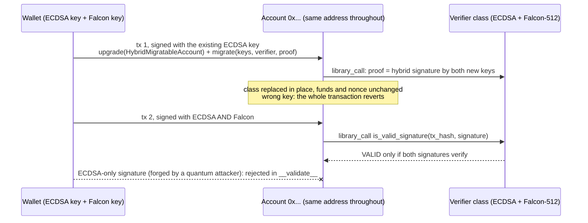

# starknet-pq-account

[](https://github.com/0xjuno/starknet-pq-account/actions/workflows/ci.yml)

Move an existing Starknet account (OpenZeppelin, Argent / Ready, Braavos) to post-quantum
signatures without changing its address or funds, back up both keys with one mnemonic, and sign
from the browser.

- Real accounts of eleven wallet classes (Argent 0.3.0 to 0.5.0, Xverse, OKX, Braavos 1.0 to
  1.2, two OpenZeppelin classes) were migrated on Sepolia.
- Of the 621 BTC delegated in Starknet staking, 564 BTC (90.7%) sits in accounts this kit
  migrates today, including all ten largest delegators.
- Of 400 accounts that sent mainnet transactions in a 0.8-hour window, 362 (90.5%) use a class
  this kit migrates. See [`contracts/docs/wallet-coverage.md`](contracts/docs/wallet-coverage.md).

> **Experimental. Unaudited. Testnet only.** Do not hold real funds with these contracts.

**Try it:** [0xjuno.github.io/starknet-pq-account](https://0xjuno.github.io/starknet-pq-account/)
and press "Use the public demo account". The page restores both keys inside the tab and sends a
hybrid-signed Sepolia transfer.


## Why

StarkWare's own assessment of Starknet accounts:

- "Standard Starknet accounts still sign with elliptic-curve cryptography." ... "Account signing is
  only demonstrated. Its implementations are unaudited, and an ordinary user can't adopt it yet."
  ([StarkWare, 2026-10-13](https://starkware.co/blog/what-chains-can-become-post-quantum/))
- "Existing accounts do not change automatically. Wallet support, signing, key management,
  recovery, custody, audits and adoption remain separate work." "Wallet and custody teams decide
  whether to integrate it." ([StarkWare migration register](https://quantum.starkware.co/migration-register))
- "Starknet accounts can swap their verification logic in place, with the same address and same
  assets" ([StarkWare, 2026-07-20](https://starkware.co/blog/starknets-quantum-edge-starks-and-native-account-abstraction/))

This repository is a working prototype of that migration path for ordinary accounts: the
in-place upgrade, the hybrid signature check, key backup and recovery, and browser signing.

## What is here

| Piece | What it does |
| --- | --- |
| `HybridMigratableAccount` | Thin account class for in-place migration of an existing account, and library-calls a declared verifier class. Argent accounts migrate in one call through Argent's own `upgrade(class_hash, data)` callbacks (`perform_upgrade` from 0.4, `execute_after_upgrade` in 0.3.x); Braavos and OpenZeppelin accounts use `[upgrade, migrate]` in one transaction. Every path requires a hybrid signature by both new keys, so a wrong key reverts the migration instead of locking the account. The verifier, the Falcon key and the ECDSA key can each be replaced later by a hybrid-signed self-call. |
| Wallet integration kit | [`signer/pq_account_kit.mjs`](signer/pq_account_kit.mjs): `inspectAccount` tells which wallet an address is and whether it can move today (Argent owners and guardians, Braavos hardware signers and multisig); `migrationCalls` builds the transaction for that wallet; `HybridSigner` signs afterwards with starknet.js. |
| `HybridPoseidonAccount`, `HybridShakeAccount` | Full hybrid accounts, also used as verifier classes: a transaction passes only if BOTH a STARK-curve ECDSA signature and a Falcon-512 signature verify over the same hash. |
| `HybridShakeVerifierPfSmall` | The default verifier class of release `testnet-v1`: the same SHAKE-256 Falcon-512 check with the Provably Fast `fj_dee1326c` patch, about 20M L2 gas cheaper per transfer than `HybridShakeAccount`. Chosen because it is the cheapest variant that fits in a Sepolia block when declared ([`bench/pf04`](bench/pf04/README.md)). |
| `VerifierSwitchGuard` | Lets a migrated account change its verifier without locking itself: the switch reverts unless the new verifier accepts the switch transaction's own signature (`switchVerifier` in the kit, [`bench/pf06`](bench/pf06/README.md)). |
| Release manifest | [`release/testnet-v1.json`](release/testnet-v1.json) pins every deployed class to its artifacts, sources and toolchain; `scripts/release_manifest.mjs --check` (offline) and `--chain` (Sepolia, read-only) verify it. See [`release/README.md`](release/README.md). |
| Key backup profile | One BIP39 mnemonic restores both keys. For an Argent X / Ready account, the classical key follows Argent's own derivation (checked against argent-x test vectors), so the words the user already has restore the current key and the new Falcon key. See [`contracts/docs/key-backup-v0.md`](contracts/docs/key-backup-v0.md). |
| Browser signer | Falcon-512 signing in the browser with [@noble/post-quantum](https://github.com/paulmillr/noble-post-quantum) (pure JS), converted by `signer/falcon_adapter.mjs` into the layout of the standard SHAKE-256 on-chain verifier. Demo page: [`docs/index.html`](docs/index.html). |
| Passkey lock | After one restore from the words, the page can lock the 64-byte seed with a passkey: AES-GCM under a key derived (HKDF-SHA256) from the passkey's WebAuthn PRF output, stored in that browser only. Later visits unlock with Face ID, fingerprint, Windows Hello or a security key; the words stay the backup. |
| Demo scripts | Sepolia scripts for deployment, migration, negative tests, backup/recovery and the browser path (`signer/`). |
| Quantum emergency recovery (research) | [`recovery/`](recovery/): a Cairo program that derives a wallet's Starknet key from a BIP39 seed (Braavos and Argent X derivations) so that knowledge of the seed can be proven with a STARK, for accounts that never migrated. CI generates and verifies Stwo proofs of both derivations for a public test mnemonic; zero knowledge, which a real seed needs, is still open. See its README. |

## How migration works



The diagram shows the Braavos and OpenZeppelin form. The two calls run in one transaction, so
there is no moment where the account is upgraded but unprotected. Wallets keep the classical key
under their own storage, so the key is passed in together with a proof that the owner holds both
keys:

| Wallet | Migration transaction, signed with the wallet's current key |
| --- | --- |
| Argent / Ready 0.4, 0.5; Xverse | `upgrade(HybridMigratableAccount, MigrationData)`: Argent checks SRC6 on the new class and library-calls its `perform_upgrade`, which replaces the class and registers both keys in the same call |
| Argent 0.3.0, 0.3.1; OKX | Same call. Argent replaces the class itself, then library-calls `execute_after_upgrade` with the same data |
| Braavos 1.0 to 1.2, OpenZeppelin | `[upgrade(HybridMigratableAccount), migrate(ecdsa_key, falcon_key, verifier, proof)]` |

`proof` is a hybrid signature over `poseidon(["starknet-pq-register-v1", ecdsa_key, ...falcon_key])`.
It is checked by the verifier after the keys are written; if it fails, the whole transaction
reverts and the old account stays as it was.

## Threat model

| Threat | Covered | How |
| --- | --- | --- |
| A quantum attacker derives the account's ECDSA key | Yes | Every transaction also needs the Falcon-512 signature. |
| A flaw in the Falcon implementation or in lattice assumptions | Yes | Every transaction also needs the classical ECDSA signature. |
| Lost device or key files | Yes | One 24-word mnemonic restores both keys. |
| Someone else swaps the verifier, rotates keys or upgrades the class | Yes | All of these are self-calls that need a hybrid-signed transaction. |
| Bridges (StarkGate, BTC wrappers), Ethereum settlement, data availability | No | Outside the account; see StarkWare's migration register. |
| Bugs in this code | No | Unaudited. Testnet only. |

## Security notes

Known risks, to be covered by a review before any mainnet use:

- Protections a wallet set up are not carried over: Argent guardians (recovery and escape),
  Braavos daily withdrawal limits and hardware signers, session keys and outside execution.
  `inspectAccount` lists them in `drops`, and `migrationCalls` refuses to build the transaction
  unless the caller passes `acceptDroppedProtections: true` after showing them to the user.
- The Falcon-512 verifier (OpenZeppelin cairo-pq-verifiers) is unaudited. The hybrid check keeps
  ECDSA as a second gate.
- The demo page derives and holds keys in page memory, so a compromised page leaks them.
  Production signing belongs inside a wallet.
- Falcon signing is hard to make constant-time, and the JavaScript signer has not been reviewed
  for side channels.
- If a wallet calls `upgrade` without `migrate` in the same transaction, an OpenZeppelin account
  waits in a bootstrap state that accepts one ECDSA-signed `migrate` call (it still needs the
  key-possession proof, but could be front-run once ECDSA is broken), and a Braavos account has
  no usable key at all, because its key is not stored where this class reads it. The kit always
  puts both calls in one transaction, and Argent's upgrade callbacks do both in one call.
- Every migration path checks the key-possession proof. The first OpenZeppelin path,
  `register_falcon_public_key`, registered a Falcon key without it and was removed on
  2026-10-19; Sepolia accounts migrated before that (including the public demo account) still
  run the older class.
- The storage slots the class writes (`ecdsa_public_key`, `falcon_public_key`,
  `Migratable_verifier_class_hash`) were empty on 48 mainnet accounts across 14 wallet classes
  (`signer/storage_collision_check.mjs`), and `inspectAccount` checks them again before every
  migration.
- `recovery/` is research code and is not zero-knowledge. Never run it on a real seed.

## Cost on mainnet

L2 gas from Sepolia receipts (full transactions, validation included), priced with Starknet
mainnet block 17043179 (2026-10-27 22:00 UTC: L2 gas 18.88 x 10^9 fri, L1 data gas 44.0 x 10^9
fri; STRK at $0.0465, CoinGecko). Fees are what the same transaction would cost at those prices.

| Transfer from | L2 gas | Fee on mainnet |
| --- | ---: | --- |
| OpenZeppelin ECDSA account (baseline) | 1.45M | 0.027 STRK, about $0.001 |
| Migrated hybrid account, Poseidon Falcon verifier | 15.8M | 0.30 STRK, about $0.014 |
| Migrated hybrid account, OpenZeppelin SHAKE-256 verifier | 53.9M | 1.02 STRK, about $0.047 |
| Same account and page, Provably Fast small verifier (default of `testnet-v1`) | 29.5M | 0.56 STRK, about $0.026 |

The two SHAKE-256 rows are the public demo account sending from the browser page before and after
its guarded switch ([`release/testnet-v1-evidence.json`](release/testnet-v1-evidence.json)).
Falcon verification alone, measured with snforge, is in [`bench/pf04`](bench/pf04/README.md).

One-time costs:

| Transaction | L2 gas | Fee on mainnet | Source |
| --- | ---: | --- | --- |
| Migration from Argent 0.5.0 / Braavos 1.2.0 (Sierra 1.7.0 classes), small verifier | 48.5–50.3M | about 0.95 STRK, $0.044 | `bench/pf04/sepolia.json`, clean-checkout run |
| Same, OpenZeppelin SHAKE-256 verifier | 70–75M | about 1.41 STRK, $0.066 | `bench/pf04/sepolia.json` |
| Migration from Argent 0.3.1, small verifier | 83.5M | about 1.6 STRK | `bench/pf04/sepolia.json` |
| Guarded verifier switch, either direction | 81–87M | about 1.64 STRK, $0.076 | `bench/pf06`, public demo switch |
| Declare `HybridShakeVerifierPfSmall` (once per network) | 5.44 x 10^9 | about 102.7 STRK, $4.77 (103.5 STRK paid on Sepolia) | `bench/pf04/sepolia.json` |

A switch to small pays for itself after about four transfers. Reproduce with
`node signer/mainnet_cost.mjs` (read-only).

## Results on Starknet Sepolia

| Step | Transaction |
| --- | --- |
| Hybrid account deploy (deploy tx itself hybrid-signed) | [0x18e2ed9d…](https://sepolia.voyager.online/tx/0x18e2ed9d992074cb618cc03b40618bf4de8cd7a057906ede5b96c00d46ce070) |
| In-place migration of an existing OZ account (same address) | [0x75b5c5e2…](https://sepolia.voyager.online/tx/0x75b5c5e20cb189d72f228d033627c863f781b930df07fefefc3f548186aeef0) |
| Hybrid-signed transfer after migration | [0x521ff2b3…](https://sepolia.voyager.online/tx/0x521ff2b341561abb0bc71581a4feaf650311bf0398176b5d7f1dc2c16343d57) |
| Transfer signed with keys restored from the mnemonic | [0x3ba4e173…](https://sepolia.voyager.online/tx/0x3ba4e17369011649b2ec02b97df634dfd7cd417630853300fa94b2f80484c57) |
| Account migrated with the standard SHAKE-256 verifier | [0x32e8ca84…](https://sepolia.voyager.online/tx/0x32e8ca84a51b8c78ca2a625723ee2dc60aae771da6b8ce4e1ad99bbbaccfcdb) |
| Transfer signed in a browser (ECDSA + noble Falcon-512) | [0x75c5bffb…](https://sepolia.voyager.online/tx/0x75c5bffb108e430df5cb92f3b79ba22e419a1be5a75f231bfc15289b965dd80) |
| Public demo account migrated (class with key rotation) | [0x63b59d1c…](https://sepolia.voyager.online/tx/0x63b59d1cf42250241f1c855e633ab359b6a9b5fc1fd3b8c02c0d9a2ce3962c) |
| Argent 0.5.0 account migrated in one call (`upgrade` → `perform_upgrade`) | [0x4a4d508f…](https://sepolia.voyager.online/tx/0x4a4d508ff51b0c64dbb7d4c779974b83835cfd12c6e782e277ed37233ee9d43) |
| Hybrid-signed transfer from the migrated Argent account | [0x15cae4b1…](https://sepolia.voyager.online/tx/0x15cae4b1c075e0769bb0480f4c8bbe1fc3cd46f459ae304ab80db1cadf57a91) |
| Braavos account migrated (`[upgrade, migrate]`) | [0x5ad0f10b…](https://sepolia.voyager.online/tx/0x5ad0f10bc956238502f45b420e00b82e87ba0fa58374b0767acfbfd6df3e908) |
| Hybrid-signed transfer from the migrated Braavos account | [0x1d8a44b1…](https://sepolia.voyager.online/tx/0x1d8a44b12bb51a2b5f74f2af21a1b623ed3c94a9d199a363e7137a2fb234c24) |
| Public demo account switched to the small verifier through the guard | [0xd6518422…](https://sepolia.voyager.online/tx/0xd651842233b8f5448e0453674bef2bd95afa6c2b2cc64850be84b7e7b40547) |
| Browser transfer from the public demo account, validated by small | [0x2f21884a…](https://sepolia.voyager.online/tx/0x2f21884a1ba148cda0b314262958cd28f1e9dd58c191a2fd4a7e4c344b675b2) |
| Braavos 1.2.0 migrated to small from a clean checkout, default settings | [0x25ca0a05…](https://sepolia.voyager.online/tx/0x25ca0a053a4ffd8dc240845876fd42ca491f24c8753c9404cc8bdec55662118) |

- Migrated account [`0x54370be5…4c41`](https://sepolia.voyager.online/contract/0x54370be5a940849f13c01f269d95d06c57d15495da594f3e01dfb6eebdb4c41):
  balance before 3.974179 STRK, after 3.750300 STRK; the difference equals the migration fee exactly.
- Argent [`0x61228909…023a`](https://sepolia.voyager.online/contract/0x61228909093cb162adc6e487f816a5c5845b219341914bf1ae0b4894c80023a)
  and Braavos [`0x2d21d503…2c43`](https://sepolia.voyager.online/contract/0x2d21d503e80d0725042bde6c2e9be84fad2c7f951e86628f263cc918e2b2c43)
  accounts were deployed from fresh words with each wallet's derivation, then migrated. After
  migration the stored classical and Falcon keys equal the keys derived from those words, and
  each balance dropped by exactly the migration fee.
- The same check on one real account of each of eleven wallet classes in active mainnet use
  (Argent 0.3.0, 0.3.1, 0.4.0, 0.5.0; Xverse; OKX; Braavos 1.0.0, 1.1.0, 1.2.0; two OpenZeppelin
  classes), driven only by `pq_account_kit.mjs`: all eleven migrated, matched their words, sent a
  hybrid-signed transfer and rejected an ECDSA-only one. Transactions in
  [`contracts/docs/wallet-coverage.md`](contracts/docs/wallet-coverage.md).
- ECDSA-only transfers from migrated accounts are rejected in `__validate__`.
- Declaring the thin migratable class costs about 4 STRK on Sepolia, against about 51 STRK for a
  full hybrid class, because verification is shared through a library call.
- Signatures from `@noble/post-quantum` were cross-checked against an independent Python
  computation and pass the Cairo SHAKE-256 verifier (`contracts/src/tests_browser.cairo`).
- Passkey lock, tested end to end in headless Edge with a CDP virtual authenticator (CTAP2,
  user verification, PRF): restore from words, lock, reload, unlock with the passkey, send
  ([0x70e467c5…](https://sepolia.voyager.online/tx/0x70e467c5c159390aea87a496b27f4bc69cb5b6462c6918d7050900eca7c8a67)).
  Reproduce with `node signer/passkey_e2e.mjs`.
- STRK20 privacy pool compatibility is analysed in
  [`contracts/docs/strk20-compatibility.md`](contracts/docs/strk20-compatibility.md); an end-to-end
  run still needs a Sepolia proving service.

### Public demo account

Sepolia only. These 24 words are published on purpose so anyone can try the page; the account
holds test STRK with no value and is refilled from time to time. Never paste a real wallet's words
into any web page.

```text
clip west volume icon sibling act dirt easily magnet fuel rigid robust lunar pause deer crisp reunion slogan wrist choice wisdom scene blossom salt
```

Account: [`0x343e3df5…c0db`](https://sepolia.voyager.online/contract/0x343e3df576edca452f2cc6ac5247fc38a3641912f545e25468e3b7e7de1c0db)
(the page fills the words in for you with "Use the public demo account"). Since 2026-10-27 it
uses the small verifier; the page shows the verifier under "Verifier". The page built before that
switch still works, since signing does not depend on the verifier. `node signer/backup_fixtures_check.mjs`
checks, read-only, that these words still give the keys stored on the account.

## Limits

- Testnet only. An independent review is still outstanding
  ([#9](https://github.com/Ryun1/starknet-pq-account/issues/9)).
- Unaudited. The Poseidon Falcon variant uses a Poseidon hash-to-point (cheap, non-standard); the
  SHAKE-256 variant follows the standard and costs about 3.4x the gas.
- Changing a migrated account's verifier with `set_verifier_class_hash` alone can lock it. Use the
  guarded switch (`VerifierSwitchGuard`, `switchVerifier` in the kit), which reverts unless the
  new verifier accepts the switch transaction's own signature. It works only between verifiers of
  the same scheme; see [`contracts/docs/verifier-replacement.md`](contracts/docs/verifier-replacement.md).
  The switch needs the active verifier to work: it validates the switch transaction itself, so it
  is no fallback if the active verifier breaks.
- Not supported by the guarded switch: accounts on the Poseidon verifier (a scheme change), and
  `HybridShakeAccount` deployed directly rather than through migration.
- The compact and record Provably Fast variants cannot be declared on Sepolia: their declares
  exceed the per-block L2 gas cap of 5.8 x 10^9. The small variant fits with a 6.2% margin, so a
  larger patch or a lower block cap would make it undeclarable too ([`bench/pf04`](bench/pf04/README.md)).
- After migration, wallet extras such as SRC-9 outside execution (paymasters, session keys),
  Argent guardians and escapes, and Braavos hardware signers, daily withdrawal limits and
  sessions are not available yet.
- Wallet migrations were tested on accounts with a single STARK key. An Argent account with a
  guardian needs the guardian's co-signature on the upgrade; multisig and hardware-signer
  accounts are not covered, and neither are accounts without a self-upgrade entry point. Xverse
  and OKX do not publish their key derivation, so for them only the upgrade path is tested.
- The Braavos key derivation matches third-party scripts, not published Braavos code.
- The passkey lock needs the WebAuthn PRF extension. Support differs by device, browser and
  password manager; it was tested with a Chromium virtual authenticator, not yet across real
  devices. Hardware wallet signing is open.
- The passkey protects the stored seed on one device; it does not replace the on-chain ECDSA key.
  Using the passkey itself as the classical signer (secp256r1) is a possible next step.
- Key backup reproducibility is tied to the pinned Falcon library (see the backup doc).

## Quickstart

### Reproduce release `testnet-v1` from a clean checkout

Requirements: Scarb 2.18.0, Node.js 24. No Python or falcon.py needed. These commands are the ones
run for the clean-checkout evidence in `release/testnet-v1-evidence.json`.

```sh
git clone https://github.com/Ryun1/starknet-pq-account && cd starknet-pq-account
(cd signer && npm install --no-package-lock --no-audit --no-fund)
(cd contracts && scarb build)
node scripts/release_manifest.mjs --check   # built classes = the pinned ones
node scripts/release_manifest.mjs --chain   # read-only: all pinned classes are declared on Sepolia
mkdir -p .keys   # put a funded Sepolia deployer here: deployer-ecdsa.json {"privateKey"}, deployer-address.txt
cd signer
node wallet_migrate_demo.mjs --print-config  # verifier and migratable class it will use; sends nothing
node wallet_migrate_demo.mjs braavos-1.2.0   # deploy a Braavos account, migrate it to small, test it
```

The verifier is the small one unless `PQ_VERIFIER` says otherwise: `PQ_VERIFIER=shake-baseline`
uses `HybridShakeAccount`. Unknown ids and class hashes that are not in the manifest are refused.
`node scripts/build_page.mjs` rebuilds `docs/index.html` from its template.

### Everything else

Requirements: Scarb 2.18.0, Node.js 20+ (24 for the STRK20 SDK), Python 3.11+ with `numpy`,
`pycryptodome` and `beartype`, and a [falcon.py](https://github.com/tprest/falcon.py) checkout at
commit `5145a818c9512b4a443507d3375e75dae3076af6`.

```sh
cd contracts
scarb build
scarb cairo-test          # 54 tests

cd ../signer
npm install
# set FALCON_PY_DIR to the falcon.py checkout (PQ_PYTHON, PQ_KEYS_DIR, PQ_RPC are optional)
node setup_keys.mjs     # testnet keys under .keys/ (gitignored); fund the printed address
                        # from the official faucet https://faucet.starknet.io
node demo.mjs           # declare + deploy a hybrid account, hybrid transfer
node migrate_demo.mjs   # migrate an OZ account in place
node backup_demo.mjs    # mnemonic backup and recovery
node browser_signer_check.mjs   # offline: noble signature vs Python vs Cairo fixture
node browser_setup.mjs  # SHAKE verifier + account for the browser demo (docs/index.html)
node mainnet_cost.mjs   # fee per transfer at current mainnet prices
node passkey_e2e.mjs    # demo page + virtual passkey: lock, reload, unlock, send (Chromium)
node wallet_profiles_check.mjs  # offline: Argent X derivation vs argent-x test vectors
node wallet_migrate_demo.mjs    # deploy and migrate real accounts of eleven wallet classes
node mainnet_survey.mjs 400     # read-only: which recent mainnet senders could migrate
node btc_staking_coverage.mjs   # read-only: how much staked BTC sits in migratable accounts
```

## Credits

Built on [OpenZeppelin cairo-pq-verifiers](https://github.com/OpenZeppelin/cairo-pq-verifiers)
(MIT), [falcon.py](https://github.com/tprest/falcon.py) (MIT) and
[@noble/post-quantum](https://github.com/paulmillr/noble-post-quantum) (MIT). See
[NOTICE.md](NOTICE.md). License: MIT.
